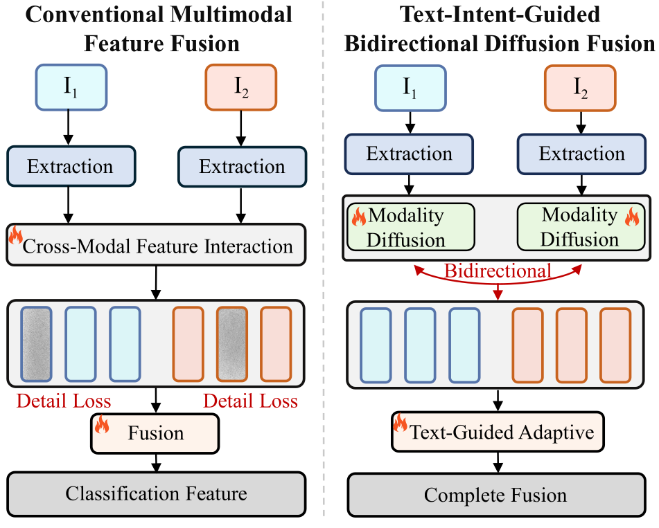
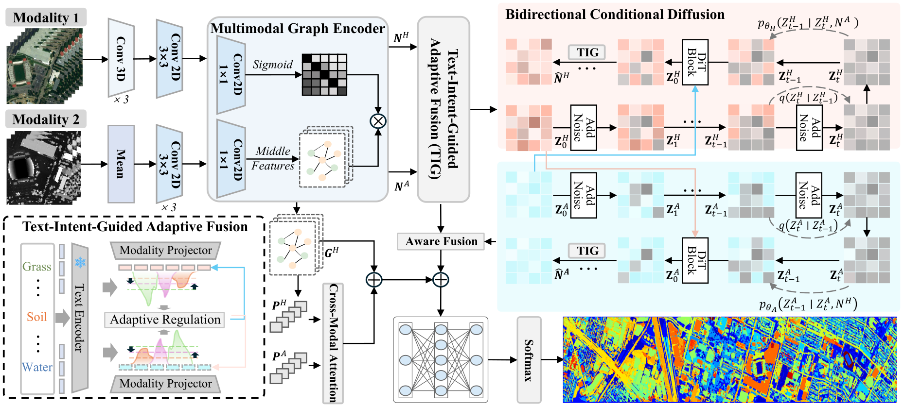
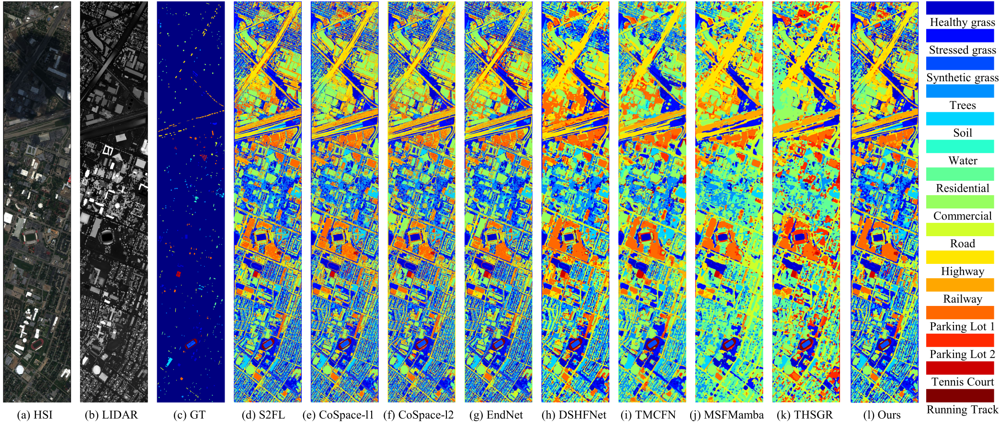
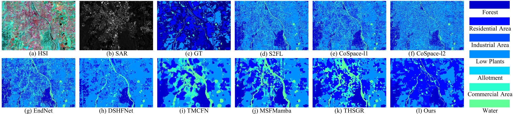
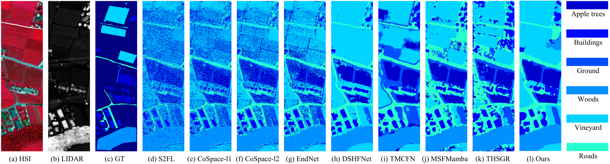
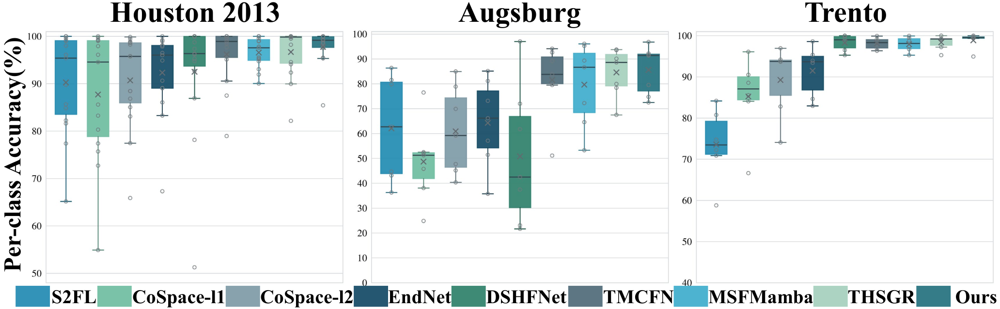

<div align="center">

# BCDiff

### Bidirectional Cross-Modal Diffusion Incorporating Text-Intent-Guided Fusion for Multimodal Remote Sensing Classification

Official project page and preview release.



</div>

## Contributions

- We propose a diffusion-driven bidirectional cross-modal feature fusion framework for multimodal remote sensing land cover classification. Bidirectional conditional diffusion reconstructs each modality under guidance from the other and progressively models intermodal dependencies, improving multimodal fusion and feature discriminability.
- We propose a text-intent-guided adaptive fusion mechanism. Text priors guide diffusion reconstruction and regulate reconstructed features to reduce noise interference in feature fusion.
- Experiments are conducted on three real multimodal datasets. These datasets cover different sensor combinations and diverse land cover scenes. Our method outperforms other advanced methods and achieves superior classification performance.

## Framework

<div align="center">
  
</div>

## Quantitative Results

The table reports **OA (%) / AA (%) / κ (×100)** under the experimental protocol used in the paper.

| Method | Houston 2013 | Augsburg | Trento |
|:--|:--:|:--:|:--:|
| S2FL | 89.75 / 90.26 / 88.91 | 61.21 / 62.07 / 51.19 | 71.35 / 73.59 / 62.83 |
| CoSpace-l1 | 87.14 / 87.71 / 86.08 | 45.13 / 48.71 / 32.94 | 82.30 / 85.22 / 76.95 |
| CoSpace-l2 | 90.34 / 90.70 / 89.54 | 61.79 / 60.87 / 51.46 | 86.40 / 89.23 / 82.14 |
| EndNet | 92.38 / 92.33 / 91.75 | 69.32 / 64.26 / 59.95 | 90.75 / 91.47 / 87.72 |
| DSHFNet | 91.15 / 92.50 / 90.43 | 63.33 / 50.77 / 46.86 | 98.91 / 98.28 / 98.53 |
| TMCFN | 95.22 / 96.18 / 94.83 | 85.46 / 81.54 / 80.03 | 98.35 / 98.12 / 97.80 |
| MSFMamba | 95.90 / 96.58 / 95.57 | 88.89 / 79.62 / 84.51 | 98.16 / 97.93 / 97.54 |
| THSGR | 95.85 / 96.69 / 95.51 | 88.70 / 84.54 / 84.17 | 98.38 / 98.35 / 97.84 |
| **BCDiff (Ours)** | **97.31 / 97.75 / 97.09** | **91.13 / 85.53 / 87.61** | **99.18 / 98.85 / 98.91** |

## Qualitative Results

### Houston 2013

<div align="center">
  
</div>

### Augsburg

<div align="center">
  
</div>

### Trento

<div align="center">
  
</div>

## Per-Class Accuracy Distribution

<div align="center">
  
</div>

## Environment

Create the reference Conda environment with:

```bash
conda env create -f environment.yml
conda activate bcdiff
```

The environment file provides a compatible reference setup. CUDA and PyTorch builds may be adjusted to match the local hardware.

## Reference Configurations

Dataset-level reference configurations are provided for:

- [Houston 2013](configs/houston.yaml): HSI + LiDAR;
- [Augsburg](configs/augsburg.yaml): HSI + SAR;
- [Trento](configs/trento.yaml): HSI + LiDAR.

## Release Status

This preview release provides the project overview, reference environment, dataset configurations, quantitative results, and experimental visualizations. Additional implementation details will be made available after publication.

## Citation

Citation information will be updated when the paper becomes publicly available.
